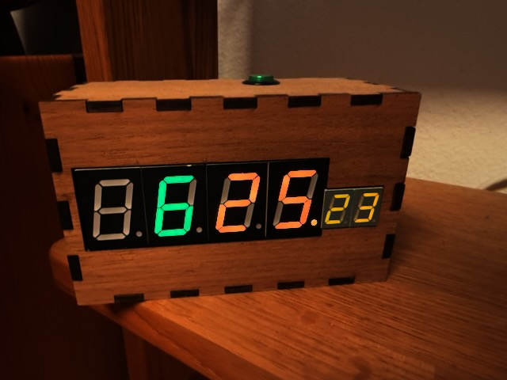

# Sevensegment-Clock

A NeoPixel seven-segment clock in a finger-jointed wooden box. It has been sitting on my
shelf telling the time since 2020, which is longer than most of my projects survive.



*Hours in green, minutes in orange, seconds ticking away on the small display at the right.*

---

## How it works

The four big digits aren't a display module — they're **32 individually addressable NeoPixels**
(`board.D18`, brightness 0.9), seven per digit plus the dots between them. Lighting up a "5"
means turning on the right six pixels and blanking the seventh.

Because every segment is its own LED, every segment can have its own colour. A colour pattern
is a small function that is asked "which colour for this segment of this digit, right now?",
which is all it takes to get gradients, rainbows and patterns that move.

The small two-digit seconds display on the right is a different animal — a conventional
seven-segment display driven through a **74HC595 shift register**, clocked out bit by bit in
`hc595_shift()` over three GPIO lines (SDI, RCLK, SRCLK).

The **dots along the bottom** are the other way of watching the seconds: one dot travels
across the display and back again, one step per second, so you can see time passing out of
the corner of your eye without reading anything.

### The button

One push button on top (GPIO 20), three jobs, depending on how long you hold it:

| Press | What happens |
|---|---|
| Short press | Next colour pattern |
| Hold 2 seconds, then let go | Wi-Fi on or off |
| Hold 6 seconds | The Pi shuts down |

The digits show what is going on. After two seconds of holding they show in blue what letting
go will do (`on` or `oFF`). Switching the Wi-Fi on lets blue bars climb like a signal meter
until the Pi is really connected, then a green `on` — or a red `Err` if it gives up. Holding on
for six seconds shows a red `bYE` before the Pi powers off.

### Colour patterns

The first fifteen presses go through the fixed patterns. After that every press makes a new
random one. Leave the button alone for a minute and the next press starts at number 1 again.
In every pattern the hours look different from the minutes.

| # | Name | What it does |
|---|---|---|
| 1 | Horizon | An evening sky inside each digit: violet at the top, amber at the bottom |
| 2 | Rainbow | A rainbow across the whole clock |
| 3 | Fire | Flickering flames, the minutes burning hotter than the hours |
| 4 | Ocean | Waves rolling across, deep blue hours and sea green minutes |
| 5 | Aurora | Northern lights drifting between green, turquoise and violet |
| 6 | Neon | Lying segments pink and standing segments cyan, swapped for the minutes |
| 7 | Candy | Every digit its own colour |
| 8 | Ice | White fading to deep blue, the minutes upside down like a reflection |
| 9 | Lava | Red and orange hours, pink minutes, slowly flowing |
| 10 | Rainbow flow | The rainbow travelling across the clock |
| 11 | Scanner | A bright spot sweeping from side to side |
| 12 | Stars | A night sky with single segments twinkling |
| 13 | Royal | Gold and violet, swapped between hours and minutes |
| 14 | Swiss | Red hours, white minutes |
| 15 | Time wheel | The colour shows the minutes: once around the colour wheel every hour |

The patterns live in the `COLOR_SETTINGS` list in the script, one line each, so they are easy
to change, reorder or add to.

### Night and sunset

- **From 23:00 to 6:00** the digits turn a faint red, one dot blinks between the hours and the
  minutes, and the seconds display goes dark.
- **In the hour before sunset** the digits turn amber and get redder the closer the sunset is.
  Sunset is calculated on the Pi from `LATITUDE` and `LONGITUDE` in the script, so it needs no
  internet and follows the seasons.

### Keeping time

A Pi Zero has no real-time clock of its own. The clock has a **DS3231 module** that keeps the
time while the power is off, and the Pi corrects itself from the internet (NTP) whenever it is
online. A cron job switches the Wi-Fi on for ten minutes twice a day for exactly that, and the
button can switch it on whenever I want to log in.

---

## Hardware

- Raspberry Pi Zero W
- 32 NeoPixels arranged as four seven-segment digits plus dots, on GPIO 18
- 74HC595 shift register driving a two-digit seven-segment display for the seconds
  (SDI on GPIO 23, RCLK on GPIO 27, SRCLK on GPIO 22)
- DS3231 real-time clock module on I2C
- One push button on GPIO 20
- Laser-cut finger-jointed wooden case

## Dependencies

```
neopixel
adafruit-blinka
RPi.GPIO
gpiozero
```

## Running

```bash
sudo python3 timepiv15.py
```

It needs root for the NeoPixels and for switching the Wi-Fi. On the clock it is started at
boot from `/etc/rc.local`. All the settings (night hours, colours, hold times, location) are
plain values near the top of the functions that use them.

## Files

- `timepiv15.py` — the script that runs on the clock now
- `timepiv11.py` — the original from 2020, which ran for six years

---

*The original script is an early project of mine, and it shows in places — but it ran for
years without complaint, so I've left it as it was written. `timepiv15.py` builds on it; the
night mode, the colour patterns and the button handling were added in November 2026, written
together with Claude.*
